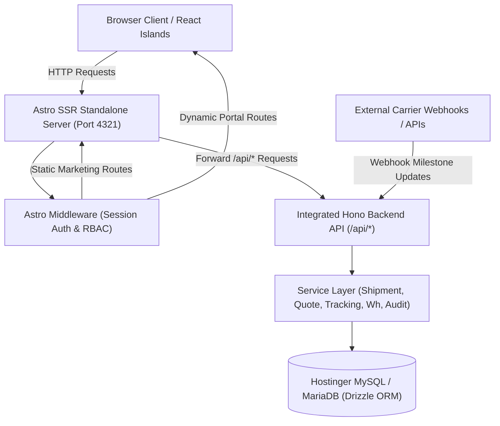

# GoShipping — System & Technical Architecture Specification

Comprehensive technical architecture for the GoShipping Enterprise Platform.

---

## 1. Architecture & Data Flow



---

## 2. Integrated Process Model (Zero Extra Port)

Unlike traditional setups that run a separate Express/NestJS server on port 3000 and Astro on port 4321, GoShipping runs in a **single Node.js process**:
- Astro Node standalone adapter (`@astrojs/node`) manages the HTTP server.
- Marketing pages (`/`, `/services`, `/about`, `/contact`) are statically prerendered at build time.
- Dynamic routes (`/dashboard`, `/admin`) are server-rendered on demand.
- The entire Hono API is mounted inside [`src/pages/api/[...path].ts`](file:///Users/jitkumarsaha/Projects/Goshipping/src/pages/api/[...path].ts):
  ```typescript
  export const ALL: APIRoute = async (context) => {
    return app.fetch(context.request);
  };
  ```

---

## 3. Database Architecture (16 Tables)

Defined using **Drizzle ORM** in [`src/server/db/schema.ts`](file:///Users/jitkumarsaha/Projects/Goshipping/src/server/db/schema.ts):

| Table | Purpose |
|---|---|
| `users` | Account identity, credentials (bcrypt hashes), role assignment |
| `sessions` | Server-side session tokens, user agents, expiration timestamps |
| `roles_permissions` | RBAC permission matrix mapping |
| `customers` | Corporate customer profiles, tax IDs, trade licenses, addresses |
| `shipments` | Master shipment records, tracking codes, carrier waybills, status |
| `shipment_events` | Verified event timeline milestones with waypoint coordinates |
| `shipment_items` | Cargo package dimensions, gross weight, CBM, declared value |
| `quotes` | Quotation inquiries, cargo specs, target dates, lifecycle state |
| `quote_revisions` | Versioned tariff pricing (base freight, fuel, customs, handling) |
| `quote_items` | Granular rate line items per quotation revision |
| `warehouses` | International hub locations, capacity utilization, station managers |
| `documents` | Protected airway bills, invoices, customs clearance declarations |
| `notifications` | In-app alerts, shipment milestones, status updates |
| `audit_logs` | Immutable admin & security action logs with caller IPs |
| `site_content` | Dynamic announcements, localized notices, FAQ items |
| `system_settings` | Operational rates, default currency, API credentials |

---

## 4. Authentication & Server-Side RBAC

- **Session Security**: Cryptographically secure 32-byte tokens saved in HttpOnly, `SameSite=Lax` cookies.
- **Roles Matrix**:
  - `super_admin`: Full system control, rate overrides, audit logs.
  - `ops_manager`: Shipment creation, warehouse allocation, tracking milestones.
  - `warehouse_staff`: Cargo receipt, weighing, package inspection, milestone events.
  - `sales_team`: Customer management, quotation tariff calculations & revisions.
  - `support_agent`: Tracking inquiries, issue triage.
  - `customer`: View owned shipments, request quotes, accept pricing, download documents.
- **Server-Side Enforcement**: [`src/middleware.ts`](file:///Users/jitkumarsaha/Projects/Goshipping/src/middleware.ts) rejects unauthorized requests before rendering or executing database queries.

---

## 5. Live Tracking & Adaptive Polling Protocol

1. **Lightweight Polling**: Active tracking pages query `/api/tracking/:code` every 20–30 seconds.
2. **Conditional 304 Caching**: Responses include a hash header (`lastHash`). When unchanged, the server returns `304 Not Modified`, saving server bandwidth and database queries.
3. **Tab Inactivity Pause**: Polling automatically pauses via `document.hidden` event when the browser tab is in the background.
4. **GPS Privacy Rule**: Country route estimations are never disguised as live GPS. Only verified coordinates from capable carriers or warehouse scanners are emitted.

---

## 6. Hostinger Deployment Guide

1. **Connect GitHub Repository**: Link this repository to your Hostinger Cloud / VPS dashboard.
2. **Environment Variables**: Configure variables matching [`.env.example`](file:///Users/jitkumarsaha/Projects/Goshipping/.env.example).
3. **Build Command**: `npm run build`
4. **Start Command**: `npm start` (Executes `node ./dist/server/entry.mjs`)
5. **Port**: 4321 (or Hostinger assigned port via `process.env.PORT`).
