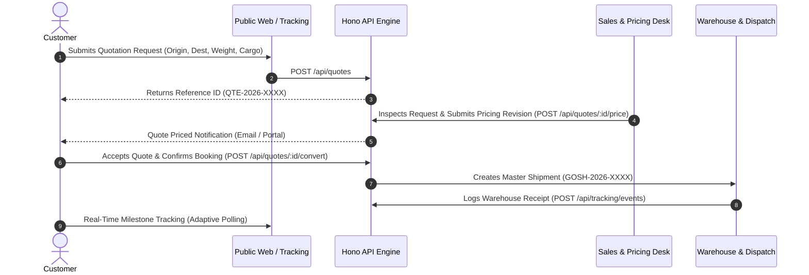

# GoShipping — Product Map & User Journeys

Router file for product functionality, customer flows, and operations modules.

---

## 1. Product Capabilities Matrix

### Public Website (SSR-Powered with Dynamic Domain & Tracking)
- **Homepage (`/`)**: Value proposition, industrial scroll showcase (`Everything your freight needs. Under one group`), reach stacker & heavy hauler animations, interactive live tracking widget, rate estimator.
- **Freight Services Hub (`/services`)**: Central directory linking all dedicated specialized cargo services.
- **Air Freight Dedicated Page (`/services/air-shipment`)**: 3–7 day air cargo from Guangzhou/Shenzhen to Dhaka HSIA with volumetric calculation formula and Air Service Schema.
- **Ocean Freight Dedicated Page (`/services/sea-shipment`)**: FCL & LCL container specifications, 35–45 day transit, Chittagong Port handling, and Ocean Service Schema.
- **Door-to-Door DDP Dedicated Page (`/services/door-to-door`)**: All-inclusive DDP logistics covering customs clearance and delivery across all 64 districts in Bangladesh.
- **Customs Clearance Dedicated Page (`/services/customs-clearance`)**: Port & airport C&F brokerage, HS Code advisory, ASYCUDA World filing, and customs documentation checklist.
- **China Warehousing Dedicated Page (`/services/china-warehouse`)**: 30 days free storage in Guangzhou, Yiwu, and Shenzhen, package inspection, and multi-supplier consolidation.
- **How It Works (`/how-it-works`)**: 6-step importer workflow with HowTo schema and tips for buying from 1688/Alibaba.
- **Shipping Rates & Quote (`/quote`)**: Dedicated rate calculation and inquiry submission page with live `QuoteCalculatorIsland`.
- **Frequently Asked Questions (`/faq`)**: Categorized questions with Schema.org `FAQPage` rich snippet accordions.
- **Network & Fleet (`/about`)**: Corporate credentials, China warehouse network, and AboutPage schema.
- **Global Hubs (`/contact`)**: Regional dispatch directory (Dhaka, Chittagong, Guangzhou, Yiwu, Shenzhen).
- **Public Tracking Portal (`/tracking`)**: Unified universal searchbar (single input for Tracking Code / AWB / BOL, Importer Account Email, or Consignee Phone Number) with dynamic real-time database queries, single-action `Track` button, direct `Link` share copier, zero sample mock strings, guest Consignment History (no login required), 48x48 product thumbnails, inline accordion details expansion, and 8-stage live progress bar.
- **Compliance & Legal (`/privacy` & `/terms`)**: Data privacy and maritime/air carriage terms.
- **SEO Infrastructure (`/sitemap.xml` & `/robots.txt`)**: Dynamic XML sitemap and search engine crawler instructions.
- **Enterprise Auth (`/login`, `/signup` & `/logout`)**: Horizon split-modal authentication with brand crimson `#EA1D2C` actions, live dashboard previews, 1-click role testing, dynamic session sync, and one-click secure sign-out.

### Customer Portal (`/dashboard`)
- **Overview**: Active consignments, priced quotes ready for acceptance, corporate credit limit.
- **My Shipments**: Searchable records, package details, item weights, and direct tracking link (populated automatically when Operations books for the customer profile).
- **Live Tracking**: Deep-dive milestone viewer with auto-refresh and carrier waybill details.
- **Request Quote ("Ship for Me")**: Interactive multi-step form capturing route, cargo dimensions, packaging, and contact details for Operations pricing. Direct customer booking is gated to ensure customs compliance.
- **My Quotations**: Tariff revision history with itemized charge breakdowns (freight, bunker surcharge, customs, terminal handling) and WhatsApp Ops inquiry integration.
- **Documents & Invoices**: Encrypted Master Airway Bills (MAWB), Commercial Invoices, and Customs slips.
- **Profile & Settings**: Corporate identity, registered tax/BIN number, primary dispatch contacts.

### Admin & Operations Control (`/admin`)
- **Operations Overview**: KPI status cards (in-flight shipments, pending quotes queue, customs clearance backlog, warehouse occupancy).
- **Users & Staff Directory (`/admin?tab=users`)**: Full enterprise user management (Add User, Edit Profile, Suspend/Activate Account, and Delete User).
- **Super Admin Ghost Login (Masquerade)**: 1-click instant login as any user without password, viewing their customer portal directly with an amber Masquerade notification bar and safe session restore.
- **Shipment Management**: Create master consignments with dynamic customer profile binding (auto-populating importer details and linking tracking directly to customer portal), assign carrier flight/vessel booking, update status, and interactive route/method picker using [`src/components/admin/ReferenceSelect.tsx`](file:///Users/jitkumarsaha/Projects/Goshipping/src/components/admin/ReferenceSelect.tsx) with floating menu cards and solid checkmark badges.
- **Milestone Logging**: Record verified checkpoint events with location name, description, and source attribution.
- **Commercial Tax Invoicing (`/admin?tab=invoices`)**: Complete commercial billing desk with dynamic multi-currency settlement bank routing (Bangladesh Standard Chartered, City Bank, BRAC, DBBL, Malaysia Maybank, CIMB, and editable custom accounts), Mushak 6.3 tax compliance, and direct vector PDF invoice generation and download via [`src/lib/invoicePdf.ts`](file:///Users/jitkumarsaha/Projects/Goshipping/src/lib/invoicePdf.ts) without print dialog popups.
- **Quotation Pricing Engine**: Commercial review, tariff calculator, pricing revision builder, quote-to-shipment conversion.
- **Warehouse Facilities**: Hub monitoring (capacity square footage and occupancy %).
- **Audit Logs**: Immutable timeline of security logins, rate adjustments, and status transitions.
- **Resend Email Telemetry & DNS Diagnostics**: Transactional email dispatch from verified branded domain `send.goshipping.com.bd` via Resend API, with automated triggers for quotes, waybills, milestone events, and onboarding.

---

## 2. Customer Journey Workflow

