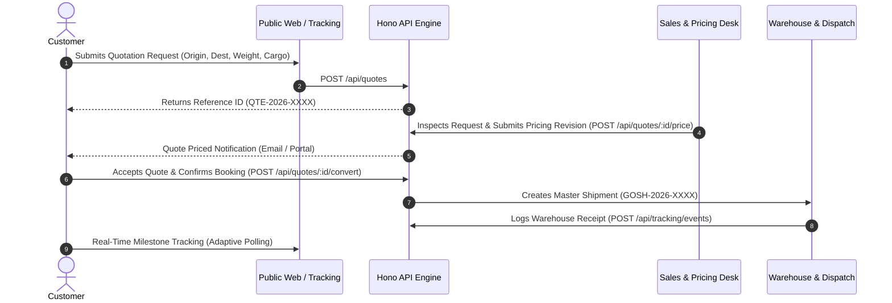

# GoShipping — Product Map & User Journeys

Router file for product functionality, customer flows, and operations modules.

---

## 1. Product Capabilities Matrix

### Public Website (Prerendered Static-First)
- **Homepage (`/`)**: Value proposition, air & ocean statistics, interactive live tracking widget, rate estimator.
- **Freight Services (`/services`)**: Detailed service pages for Air Cargo, Ocean Container (FCL/LCL), Bonded Warehousing, and Customs Brokerage.
- **Network & Fleet (`/about`)**: Corporate credentials, IATA / BAFFA / FIATA memberships, global throughput figures.
- **Global Hubs (`/contact`)**: Regional dispatch directory (Dhaka, Chittagong, Dubai, Guangzhou).
- **Public Tracking Portal (`/tracking`)**: Waypoint timeline search with quick test codes.

### Customer Portal (`/dashboard`)
- **Overview**: Active consignments, priced quotes ready for acceptance, corporate credit limit.
- **My Shipments**: Searchable records, package details, item weights, and direct tracking link.
- **Live Tracking**: Deep-dive milestone viewer with auto-refresh and carrier waybill details.
- **Request Quote**: Interactive multi-step form capturing route, cargo dimensions, packaging, and contact details.
- **My Quotations**: Tariff revision history with itemized charge breakdowns (freight, bunker surcharge, customs, terminal handling) and one-click booking acceptance.
- **Documents & Invoices**: Encrypted Master Airway Bills (MAWB), Commercial Invoices, and Customs slips.
- **Profile & Settings**: Corporate identity, registered tax/BIN number, primary dispatch contacts.

### Admin & Operations Control (`/admin`)
- **Operations Overview**: KPI status cards (in-flight shipments, pending quotes queue, customs clearance backlog, warehouse occupancy).
- **Shipment Management**: Create master consignments, assign carrier flight/vessel booking, update status.
- **Milestone Logging**: Record verified checkpoint events with location name, description, and source attribution.
- **Quotation Pricing Engine**: Commercial review, tariff calculator, pricing revision builder, quote-to-shipment conversion.
- **Warehouse Facilities**: Hub monitoring (capacity square footage and occupancy %).
- **Audit Logs**: Immutable timeline of security logins, rate adjustments, and status transitions.

---

## 2. Customer Journey Workflow

